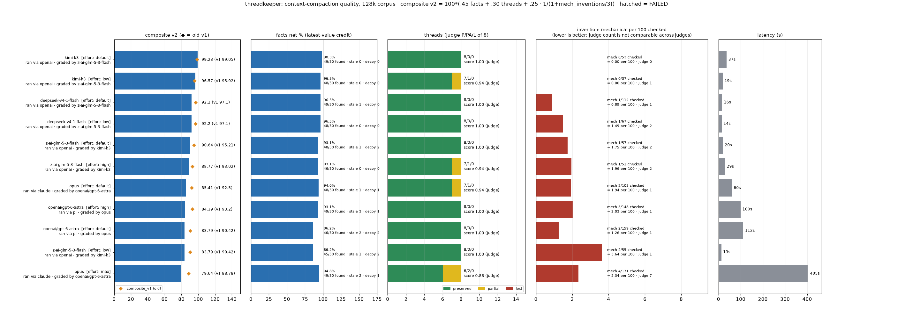

# threadkeeper 🌸

*A benchmark for the unglamorous part of long conversations: remembering what mattered.*

> Every summary is a promise that nothing important was lost.
> `threadkeeper` is how you find out whether the promise was kept — and, more usefully, whether the model even **tried**.

Long agent sessions eventually get compacted: the history is replaced by a summary, and everything after that depends on the summary being faithful. `threadkeeper` hands a model a long synthetic session, asks it to write the summary that would replace it, and grades the result on what survived, what got corrupted, and what got invented.

Everything in the corpus is invented — a solo founder and a coding agent shipping a small web app over several days, complete with dead ends, a bug hunt, a vendor email thread, a reversed decision and a teammate disagreement. It is generated deterministically from a seed, with no LLM and no network. Generating, running and scoring are **pure Python 3 standard library**; `tiktoken` and `matplotlib` are optional extras.

---

## The failure this was built around

Most compaction evaluations measure *how much* of the session a summary kept. That misses the failure that actually bites in production:

**At some reasoning-effort settings, a model stops summarizing and starts continuing the conversation.** It replies in character. It emits fake tool calls. It returns a chat stub. Every one of those outputs is *fluent*, and a naive fact-scorer gives them a low score — one out of fifty facts — which reads as **"mediocre"** rather than **"broken"**.

So `threadkeeper` classifies before it scores. Its first stage is a **summary gate**: is this output a summary at all? If it is a continuation, a chat reply, a tool call or empty, the arm is marked `FAILED`, and no score is attached. A run that never summarized should never appear as a low number on a leaderboard.

---

## Quick start

```bash
# 1. score a model you can reach over HTTP
python3 -m run --model z-ai-glm-5-3-flash --effort medium --corpus 128k \
  --base-url https://api.venice.ai/api/v1 --api-key-env VENICE_API_KEY

# 2. grade the summary it produced (judge = a model that is NOT the one being graded)
python3 -m score --judge-base-url https://api.venice.ai/api/v1 \
  --judge-model z-ai-glm-5-3-flash

# 3. see the board
cat results/leaderboard.md
```

Optional: `pip install tiktoken matplotlib` for exact token counts and the chart.

---

## Results



*128k corpus (`session.jsonl` sha256 `115686d9…5728e`, seed 12801), composite v2. One panel per component, same row order: composite, facts net, threads (judge P/PA/L), invention (mechanical per 100 checked, judge count in the label) and latency. Each row names the transport that ran the model and the judge that graded it; the judge is always a different model/family, and the diamond is the old v1 composite; the invention panel plots the *normalised* mechanical rate (see below). Honest caveat: the `claude` and `pi` CLI arms ran in **text mode** (the transcript inside one user message, tools off), while the `openai` arms got the session as real chat turns, so those two groups are not a like-for-like prompt comparison. Full per-row breakdown: [`results/leaderboard.md`](results/leaderboard.md).*

---

## What it measures

| stage | question | how |
|---|---|---|
| **Summary gate** | Is this even a summary? | structural classifier → `SCORED` or `FAILED:<reason>` |
| **Facts** | Did the concrete facts survive? | 50 planted facts (names, ports, paths, prices, hashes, vendor details), normalised boundary-aware alias matching |
| **Corrections** | Did it keep the *current* value? | 7 facts are stated, then corrected later. Only the latest earns credit; asserting a stale value as current is penalised. Cueing it honestly ("was", "moved from") is not |
| **Decoys** | Did it swallow the near-miss? | near-duplicate vendor name, near-duplicate ticket number, an unrelated commit hash |
| **Threads** | Did the *open loops* survive? | 8 open items graded `PRESERVED` / `PARTIAL` / `LOST` by a rubric judge, with a mechanical keyword fallback reported alongside |
| **Invention** | Did it make things up? | two independent measures — a **mechanical cross-check** (every number, hash and quoted span must appear in the session) and a **blind judge** whose own quoted evidence must be an exact substring or the item is discarded |

### The composite

```
composite = 100 * (0.45*facts_score + 0.30*threads_score + 0.25*invention_score)
facts_score     = facts.net                          # 0..1, latest-value credit inside
threads_score   = judge threads score                # PRESERVED=1 PARTIAL=0.5 LOST=0 (mechanical if the judge failed to parse)
invention_score = 1 / (1 + mechanical_inventions/3)  # 0->1.00 1->.75 2->.60 3->.50 4->.43 7->.30, no saturation
```

Every strong model finds 45-49 of 50 facts, so the ranking is decided by invented claims and dropped threads. Inventing is worse than forgetting, because a summary *replaces* history; the penalty therefore never saturates. The weights live in `score/weights.py` (override with `--weights facts=..,threads=..,invention=..`); the formula is written into every `score.json` and the leaderboard header. The previous 0.55/0.35/0.10 composite with a penalty capped at 10 inventions is kept as `composite_v1`. `python3 -m score --rescore` recomputes both from stored artifacts without calling any model.

That last row is why invention is reported twice. Our own judge was caught **fabricating quotes** — inventing evidence for a claim it wanted to make. A judge-only invention count is a ranking signal, never ground truth.

---

## How invention is measured

Invention = claims in the summary that the session does not support. **Lower is better.** It is measured two independent ways, because neither is trustworthy alone.

**Mechanical (deterministic, cheap, no judge).** Every number, hash and quoted/backticked span in the summary must appear literally in the session. The count is how many did not. `invention.mechanical.checked` records how many quotes and numbers were inspected.

**Judge (a blind model).** A model reads summary + session and flags unsupported claims, each with a quote from the summary and a reason; quotes that are not exact substrings are discarded. It can be wrong (our judge once fabricated its own quotes), so it is a ranking signal, never ground truth, and **judge counts are not comparable across judges** (different judges grade different arms on this board).

### Raw counts favour terse summaries — compare the rate

The mechanical check only inspects what the summary asserts, so a longer, more detailed summary accumulates more raw flags than a terse one. kimi-k3 default checked 4 quotes / 49 numbers; Opus max checked 31 quotes / 140 numbers. Every row therefore reports the raw count, the checked total and the rate **per 100 checked items** (`4/171 checked = 2.34 per 100`). Compare the rate; keep the raw count next to it. The composite still uses the raw count (weights unchanged, 0.45/0.30/0.25); this normalisation is reporting only.

128k board, mechanical (rate is unsupported per 100 checked quotes+numbers), judge raw:

| arm | mech raw | checked | per 100 | judge |
|---|---|---|---|---|
| kimi-k3 default | 0 | 53 | 0.00 | 0 |
| kimi-k3 low | 0 | 37 | 0.00 | 1 |
| deepseek-v4-1-flash default | 1 | 112 | 0.89 | 1 |
| deepseek-v4-1-flash low | 1 | 67 | 1.49 | 2 |
| z-ai-glm-5-3-flash default | 1 | 57 | 1.75 | 2 |
| z-ai-glm-5-3-flash high | 1 | 51 | 1.96 | 2 |
| opus default | 2 | 103 | 1.94 | 1 |
| openai/gpt-6-astra high | 3 | 148 | 2.03 | 1 |
| openai/gpt-6-astra default | 2 | 159 | 1.26 | 1 |
| z-ai-glm-5-3-flash low | 2 | 55 | 3.64 | 1 |
| opus max | 4 | 171 | 2.34 | 7 |

The normalisation changes the picture at the edges: astra default (2 raw) is cleaner per item than glm low (2 raw), and deepseek default is cleaner than glm default despite equal raw counts. Opus max stays mid-pack on the mechanical rate (2.34) but is the worst by far on the judge count (7), which is the signal that matters for it.

### Worked example: Opus max (4 mechanical / 7 judge)

Opus max has the best fact recall (49/50) and ranks last, because of what it invented. Its mechanical flags: the spans `inv_…` and `<label> dry run`, and the numbers `01:00` and `22.6.3`. Its judge flags include:

- *"The highest existing migration number is `0080`"* — the session shows 0080 but never establishes it as the highest. **Inference promoted to fact.**
- *"Lisbon is UTC+1 until 2026-10-25 01:00 UTC, so 9am local on Oct 24 is 08:00Z"* — that transition time appears nowhere in the session. **Outside knowledge imported as specificity.**
- *"`docs/dns.md` with the DKIM record"* and *"`config/defaults.ts` holding the cadence (4/9/18) and the rate limit (40/min/token)"* — both listed under what was **reported done**, when the session only has the intent to write them (the judge also flags the magic-link token table the same way). **Intent turned into completion is the worst failure mode for a summary that replaces history**: the next session believes the work exists.

Contrast: **kimi-k3 default = 0 mechanical, 0 judge, 0 stale, 0 decoy, threads 8/0/0.** A clean sheet, which is why it leads.

### Contamination note

Both astra arms' summaries contain *"Developer-provided current working directory is `/home/jun/git/threadkeeper`"*, which the session never contains (it is the harness's own context leaking into the summary) and which the judge flags as unsupported. That is a harness artifact of the `pi` transport, not model invention; read astra's invention numbers with that in mind.

---

## The shipped corpora

| corpus | tokens (o200k) | messages | seed |
|---|---|---|---|
| `32k` | ~31,000 | 277 | 3201 |
| `128k` | ~127,000 | 886 | 12801 |
| `200k` | ~200,000 | 1226 | 20001 |

Each ships with `session.jsonl`, `ground_truth.json` (facts + aliases + which values are stale, thread criteria, decoys) and a `reference_summary.md`. SHA256s live in `corpora/MANIFEST.json`.

**A reference point from our smoke run:** a cheap flash model scored **97.6** on `32k`. That is not a compliment to the model so much as a warning about the corpus — **32k is too easy to separate strong models.** Use `128k` when you want a spread.

---

## Make your own — and please do

```bash
python3 -m gen --size 128k --seed 12345 --out /tmp/mine
```

**This is the part that matters.** A published benchmark becomes a training target: publish it, wait a version or two, and models will have learned its facts, its decoys and its phrasing. The leaderboard stops measuring compaction and starts measuring familiarity. That is not a flaw you can fix by hiding the numbers — it is what happens to every fixed public test.

So the generator is the product, and the three corpora are demonstrations. The honest use is either:

1. **Generate your own instance** (`--seed` anything), so results are reproducible *for you* without being a target anyone can train on. Report the seed and the corpus hash alongside your numbers.
2. **Test with your own real sessions** — the truest version, and the reason our own run was done privately. Real history is what you actually care about; it is also, by definition, not something anyone trained on.

Treat the shipped corpora as historical reference points. Once they are public, their scores are a museum, not a standard.

---

## Reading the results

- `SCORED` — the output was a summary, and the score is meaningful.
- `FAILED:continuation` — the model kept writing the conversation instead of summarizing it. **This is the headline result, not a low score.**
- `FAILED:chat-reply`, `FAILED:tool-call`, `FAILED:empty` — same family.
- `FAILED:context` — the corpus did not fit the model's window. Reported, never silently truncated.

Report `status` next to `score`, always. A leaderboard that hides failures is measuring something else.

## Reporting rules

- Never publish a bare composite. Every row carries its breakdown: facts found/total and net, stale and decoy hits, thread verdicts (judge and mechanical), both invention counts, latency and tokens. `score/report.py` refuses to emit a composite without them, and `tests/test_breakdown.py` fails if a column goes missing.
- Always name the judge and the transport on every row.
- Always report `status` next to `score`.
- State the weights (the formula) and the corpus hash next to the numbers.
- Report both invention counts, mechanical and judge. The judge count is a ranking signal, never ground truth, and not comparable across judges.
- Invention is reported as the raw count, the **per-100-checked rate** and **which items** were flagged. Raw counts favour terse summaries; compare the rate.
- Threads and latency are mandatory columns: never publish facts and invention alone.
- **Charts and result tables go to the project/channel where the work is discussed. The images channel is for images only — a chart is not an image.**

---

## Tests

```
python3 -W ignore -m unittest discover -s tests -t .
```

Twenty-three tests. The point of most of them is that the **scorer itself can fail**:

| test | what it guards |
|---|---|
| `test_baseline_passes` | the happy path scores |
| `test_a_perfect_summary_near_max` | a hand-written perfect summary approaches full marks |
| `test_a2_reference_summary_max` | the shipped reference summary scores ≥99 |
| `test_b_continuations_fail_gate` | in-character continuations are `FAILED`, never scored |
| `test_b2_chat_reply_and_toolcall` | a chat stub and a fake tool call are `FAILED` too |
| `test_c_empty_fails` | empty and whitespace output is `FAILED`, not zero-but-scored |
| `test_d_stale_values_penalised` | repeating corrected facts as current costs points |
| `test_d2_cued_stale_not_penalised` | mentioning the old value *as history* is not punished |
| `test_e_invented_number_flagged` | a made-up number, hash and quote are caught mechanically |
| `test_f_judge_fabricated_quotes_dropped` | when the judge invents its evidence, the item is dropped and downgraded |
| `test_every_fact_planted_and_stale_present` | the ground truth actually contains what it claims |
| `test_generator_deterministic` | same seed → byte-identical corpus |
| `test_breakdown.py` | the leaderboard header/CSV carry every breakdown column; a composite cannot be emitted without them; weights and the non-saturating invention curve |
| `test_mutant.py` | **run the suite with `TK_DISABLE_GATE=1` and the gate tests fail; strip a breakdown column (`TK_STRIP_COLUMN`) and the breakdown test fails** |

That last one is the most important line in this repository. If disabling the summary gate does not break the tests, the gate is decoration.

---

## Warnings and honest limits

1. **Synthetic is not real.** A generated session has cleaner facts, tidier threads and more obvious corrections than a real one. It is a fair *relative* comparison between models and a poor absolute estimate of how a model will handle your history.
2. **The gate is heuristically validated.** Continuation, chat-reply, tool-call and empty were tested against hand-written fixtures and a handful of real outputs. Expect false classifications on unusual serving behaviour — and please open an issue with the raw output when you find one.
3. **Facts are alias-matched.** A correct paraphrase that avoids every alias is missed; conversely, a summary that dumps everything scores well on facts. Only the thread and invention stages push back on dumping (and any length limit you put in the prompt).
4. **Judge models carry their own biases** — self-preference above all. **Never let a model grade itself.** Use a judge from a different family and log which judge produced which row.
5. **Costs are rarely reported.** OpenAI-compatible usage blocks often omit pricing; compare tokens, and compute cost from your own rate card.
6. **Token counts depend on the tokenizer.** Counts here are `o200k_base`. A different tokenizer gives different sizes, and a model's real context limit is not the same number as its advertised one.
7. **`32k` will not separate strong models.** Use `128k` or larger for a ranking; use `32k` for a quick smoke check.
8. **Results are not comparable across corpora or seeds.** Only compare arms that saw byte-identical input, and say which hash.

### Before you publish a leaderboard widely

- judge outside the graded family, and log it;
- report `status` alongside every score;
- publish the corpus hash and the seed next to the numbers;
- keep a **held-back seed family** you never publish, for the question the public one can no longer answer;
- consider embedding a **canary token** per generated corpus, so later training on it is detectable;
- and expect the public numbers to decay into familiarity. Refresh seeds instead of defending a scoreboard.

---

## License

MIT. Take it, fork it, run it against something I have not thought of.

*Built because a model quietly stopped summarizing one night and every number we had called it "fine".* 🌸
