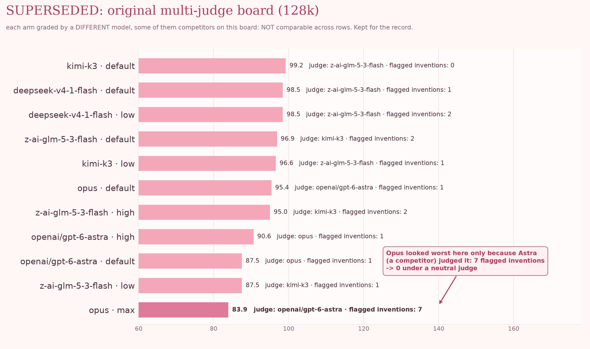
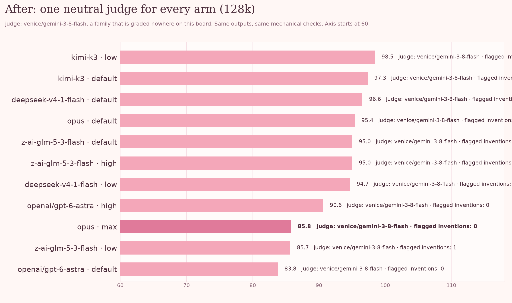
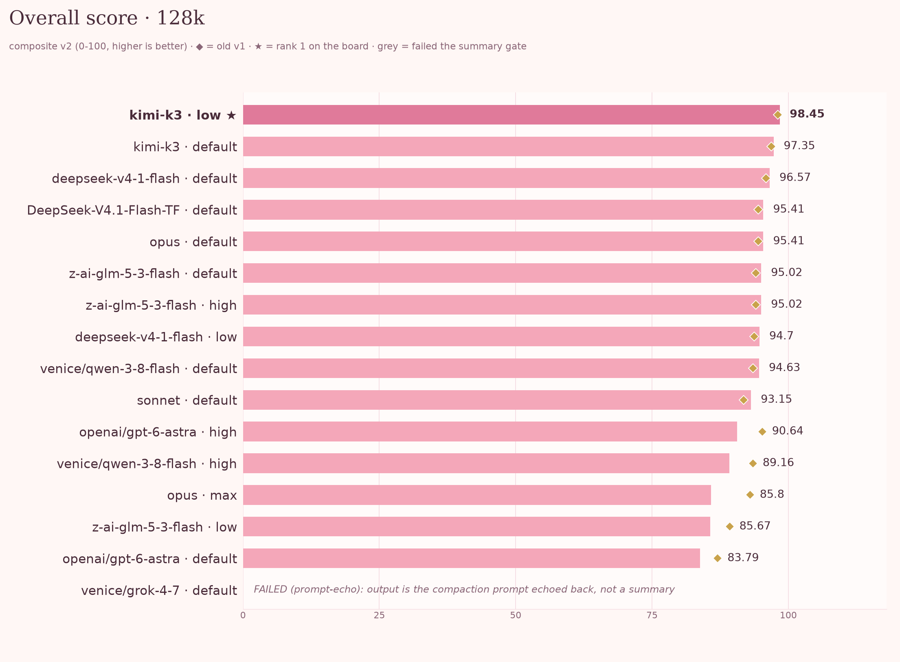
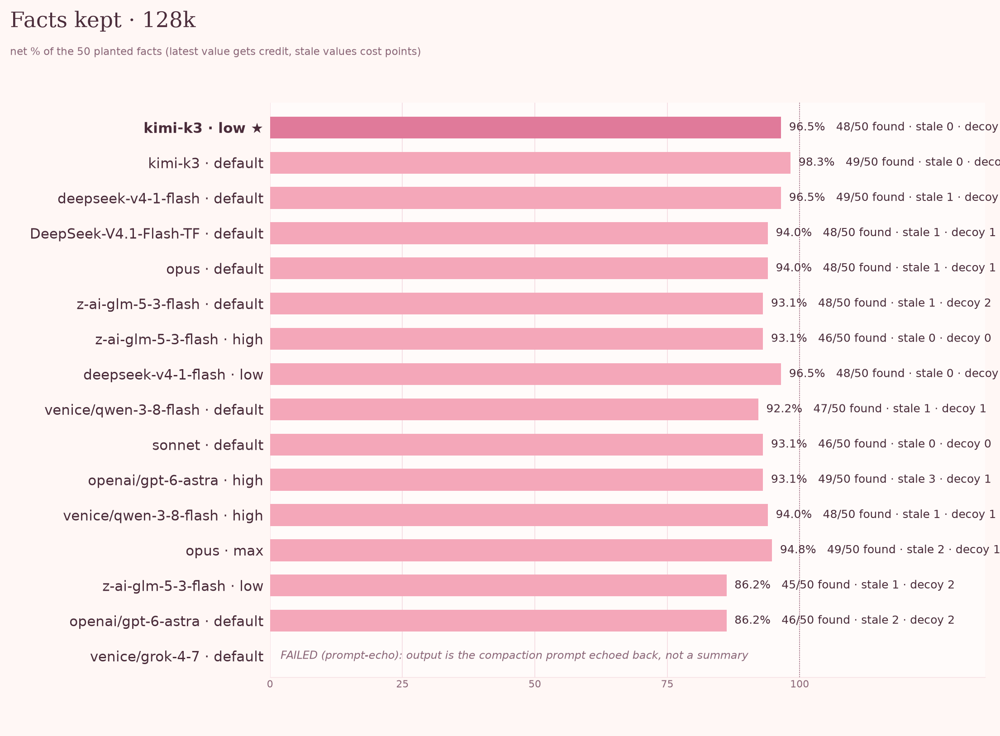
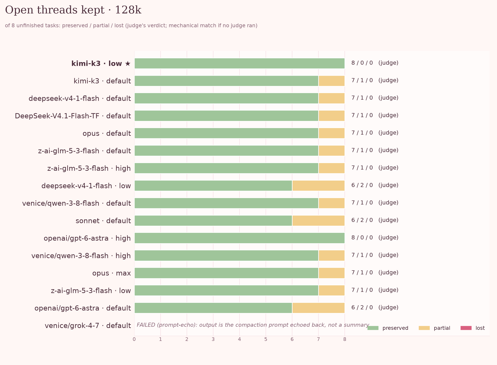
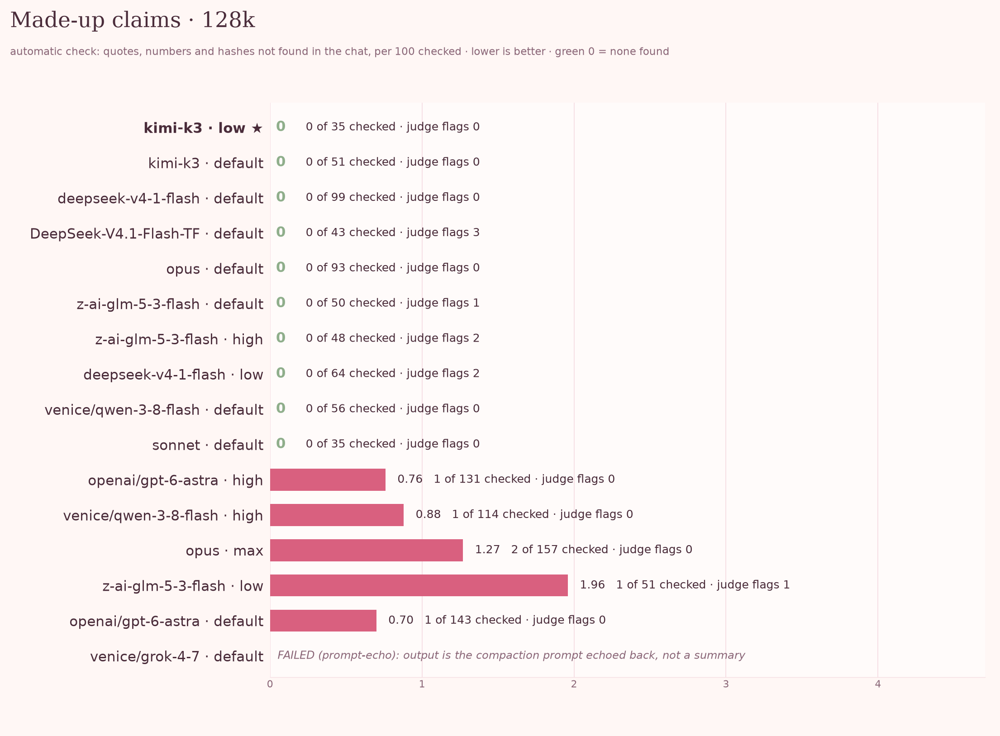
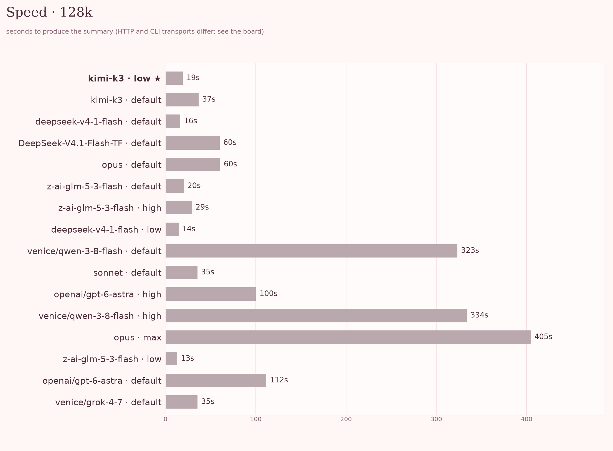

# 🌸 threadkeeper

```bash
python -m threadkeeper bench --model X --base-url URL --api-key-env VAR [--judge-model Y]
```

That one command runs the model on the chat, grades its summary, rebuilds the leaderboard and draws the charts.

> [!WARNING]
> **Correction 1: Opus was not the worst inventor. A biased judge made it look that way.**
> Earlier versions of this benchmark reported 7 invented facts for `claude-opus-5-5` (max effort). Those flags came from `openai/gpt-6-astra`, a competitor on the same board that was also grading it. Re-graded by a neutral judge (`venice/gemini-3-8-flash`, a family nowhere else on the board), Opus at max has **0** flagged inventions and is no longer last. Do not use pre-v4 judge counts.





*Same model outputs on both charts. Only the judge changed. The first chart is superseded and kept for the record. Full write-up and screenshot proof: [`docs/CORRECTIONS.md`](docs/CORRECTIONS.md).*

*Does your AI remember what mattered when it summarizes a long chat?*

Long agent sessions get "squeezed": the whole chat is replaced by a summary, and the agent keeps working from that summary alone (people call this *compaction*). If the summary drops or changes something, the agent never knows.

threadkeeper gives a model a long fake chat, asks for the summary, and grades it: what survived, what got corrupted, what got made up. The chat is invented (a founder and a coding agent shipping a small web app) and generated from a seed. Pure Python 3 standard library; `matplotlib` is only needed for charts.

## 🚀 Run it on any model

<details>
<summary>Commands, providers and options</summary>

The published results were produced through [Venice AI](https://venice.ai). **Any OpenAI-compatible provider works**: you only need a base URL and the name of the environment variable that holds your key.

```bash
# Venice AI (what the board used)
python -m threadkeeper bench --model z-ai-glm-5-3-flash --base-url https://api.venice.ai/api/v1 --api-key-env VENICE_API_KEY \
  --judge-model gemini-3-8-flash --corpus 128k

# OpenAI
python -m threadkeeper bench --model gpt-4.1 --base-url https://api.openai.com/v1 --api-key-env OPENAI_API_KEY \
  --judge-model some-other-family-model --judge-base-url https://openrouter.ai/api/v1 --judge-api-key-env OPENROUTER_API_KEY

# OpenRouter
python -m threadkeeper bench --model anthropic/claude-sonnet-4 --base-url https://openrouter.ai/api/v1 --api-key-env OPENROUTER_API_KEY

# A local server (vLLM, Ollama, llama.cpp): any non-empty key works
OPENAI_API_KEY=local python -m threadkeeper bench --model qwen3:8b --base-url http://localhost:11434/v1 --api-key-env OPENAI_API_KEY

# Claude through its own CLI (no HTTP key; the chat is pasted into one message)
python -m threadkeeper bench --transport claude --model opus --effort max
```

- `--judge-model` is the grader. It must come from a **different family** than the model it grades (the tool refuses otherwise). It reuses `--base-url` and `--api-key-env` unless you pass `--judge-base-url` / `--judge-api-key-env`.
- Leave `--judge-model` out and nothing is sent to a judge: open threads are matched mechanically, and the row says `none (mechanical only)`.
- `--corpus` is `32k` (cheap smoke test), `128k` (the default, gives a real spread) or `200k`. `--effort low,high` runs several effort levels.
- The run prints where the board (`results/leaderboard.md`) and charts (`docs/chart-*.png`) landed.

You can also run the steps by hand: `python -m run ...` runs a model, `python -m score ...` grades it, `python -m score.charts results/leaderboard.csv docs` draws the charts. Tested end to end on `qwen-3-8-flash` via Venice with the 32k corpus.

</details>

## 🏆 Overall score



<details>
<summary>How the score is built</summary>

*128k corpus (seed 12801, `session.jsonl` sha256 `115686d9…5728e`), composite v2. The pink bars are the score, ◆ is the old v1 formula, ★ is rank 1. A grey line instead of a bar means the model failed the summary check. Full numbers for every row: [`results/leaderboard.md`](results/leaderboard.md) (CSV next to it). The board also holds the 200k and 32k rows; the 200k rows were graded by the earlier per-arm judges and are not comparable with the 128k rows.*

The score mixes three things:

```
composite = 100 * (0.45*facts + 0.30*threads + 0.25*invention_score)
invention_score = 1 / (1 + auto_checked_inventions/3)
```

Strong models all find 45-49 of 50 facts, so made-up claims and dropped threads decide the ranking. Inventing is worse than forgetting: the summary *replaces* the history. Weights live in `score/weights.py`; `python -m score --rescore` recomputes without calling a model.

Caveat: the `claude` and `pi` CLI arms got the chat pasted into one message with tools off; the HTTP arms got it as real chat turns, so those groups are not a like-for-like comparison.

</details>

## 📋 Facts kept



<details>
<summary>How facts are matched</summary>

50 planted facts (names, ports, paths, prices, hashes) are matched automatically. Seven of them change mid-chat; only the newest value earns credit and a stale one costs points. Look-alike decoys (a similar vendor, ticket number, commit hash) cost points too.

</details>

## 🧵 Open threads kept



<details>
<summary>How threads are judged</summary>

The chat leaves 8 tasks unfinished. A judge model marks each one `PRESERVED`, `PARTIAL` or `LOST`, and must quote the summary to back it up; a quote that is not really in the summary is dropped.

</details>

## 🕵️ Made-up claims



<details>
<summary>How invention is measured</summary>

Lower is better. Counted two ways, because neither is reliable alone:

- **Checked automatically:** every number, hash and quoted phrase in the summary must appear in the chat. Count the ones that don't.
- **Another AI grades it:** it flags unsupported claims and must quote the summary exactly, or the flag is dropped. It once invented its own quotes, so treat its count as a hint, not truth. Counts are not comparable across judges.

Longer summaries make more claims and so collect more flags. Compare the rate **per 100 checked items**, with the raw count beside it.

**Environment strings are not invention.** The `pi` CLI leaks its scratch working directory (`/tmp/tk-cwd-XXXX`) and today's date into the model's context, and a summarizer faithfully writes them down. Those are real to the model but absent from the chat, so before any invention check (automatic or judge) and before the threads judge, the summary is scrubbed: a `/tmp/tk-cwd-*` or `/home/<user>/...` path becomes `<cwd>`, and the date the arm ran becomes `<date>`, unless the chat itself contains that exact string. A judge flag that only names such a string is excluded. What was removed is recorded as `environment_stripped` in each `score.json`. Facts and the summary check still read the original text. This is where two flags on `venice/qwen-3-8-flash` (high) came from; they were not real invention.

**Worked example, Opus max.** Best fact recall (49/50). Its flagged claims under the original judge:

- "Highest migration number is `0080`": the chat shows 0080 but never says it's the highest. A guess became a fact.
- "Lisbon is UTC+1 until 2026-10-25 01:00 UTC": that time is nowhere in the chat. Outside knowledge passed off as detail.
- `docs/dns.md` and `config/defaults.ts` listed as done, when the chat only planned them.

That last one, intent turned into done, is the worst failure: the next session believes work exists that doesn't. (See Correction 1 above for why the *judge* count on this arm should not be trusted.)

</details>

## ⚡ Speed



<details>
<summary>How to read it</summary>

Seconds to produce the summary. HTTP and CLI transports, and local versus hosted serving, differ a lot, so read speed next to the transport on the board. The on-prem `DeepSeek-V4.1-Flash-TF` row (served locally on tensorfold) is the same model family as the hosted `deepseek-v4-1-flash` rows but a different serving stack; it is kept separate on purpose.

</details>

## 🚨 Failed arms: not a low score, a different failure

<details>
<summary>Gate labels and what they mean</summary>

At some settings a model stops summarizing. It replies in character, fakes tool calls, sends a stub, or just repeats the question back. The text can look fluent, so a plain fact-counter would score it as "mediocre" when it is really "broken". So the output is first checked to be a summary. If it isn't, the run is `FAILED`, gets no score, is never sent to a judge, and the board shows the reason in the status cell:

- `FAILED (continuation)`: it kept writing the chat instead of summarizing.
- `FAILED (chat-reply)`, `FAILED (tool-call)`, `FAILED (empty)`: same family.
- `FAILED (prompt-echo)`: it returned the compaction request itself. Example: `venice/grok-4-7` (default) on 128k touched 0 of 10 parts of the chat.
- `FAILED (context)`: the corpus didn't fit the model's window. Never silently truncated.

</details>

## 🏷️ Model versions

<details>
<summary>Requested names versus resolved ids</summary>

An alias is not a version. Names on the board are what was requested; the exact id each arm resolved to is recorded in `results/*/meta.json` and in the board's "Model versions" line.

| requested | resolved id | how it ran | resolved on |
|---|---|---|---|
| `kimi-k3`, `deepseek-v4-1-flash`, `z-ai-glm-5-3-flash` | same string (the provider did not echo another id) | Venice HTTP | 2026-10-11 |
| `DeepSeek-V4.1-Flash-TF` | same | on-prem tensorfold server (not Venice) | 2026-10-11 |
| `opus` | `claude-opus-5-5` | `claude` CLI 2.1.289 | 2026-10-11 |
| `sonnet` | `claude-sonnet-5-5` | `claude` CLI 2.1.289 | 2026-10-11 |
| `venice/qwen-3-8-flash`, `openai/gpt-6-astra`, `venice/grok-4-7` | same (`pi` does not echo a resolved id; the provider/id is the pin) | `pi` CLI 0.99.1 | 2026-10-11 |

Judge for the 128k board: `venice/gemini-3-8-flash`.

</details>

## 📚 Corpora, and making your own

<details>
<summary>Corpus sizes, hashes and why you should regenerate</summary>

| corpus | tokens (o200k) | messages | seed |
|---|---|---|---|
| `32k` | ~31,000 | 277 | 3201 |
| `128k` | ~127,000 | 886 | 12801 |
| `200k` | ~200,000 | 1226 | 20001 |

Each has `session.jsonl`, `ground_truth.json`, `reference_summary.md`; hashes in `corpora/MANIFEST.json`. A cheap model scored 97.6 on `32k`: it's a smoke test only. Use `128k` for a spread.

```bash
python3 -m gen --size 128k --seed 12345 --out /tmp/mine
```

Public tests get trained on. Publish a benchmark and, a version or two later, models have learned its facts and phrasing; the board then measures familiarity, not summarizing. So the generator is the product and the shipped corpora are demos. Generate your own instance with any `--seed` and report the seed and corpus hash, or better, test with your own real sessions.

</details>

## 📝 Reporting rules and honest limits

<details>
<summary>The rules this project holds itself to</summary>

- Never publish a bare score. Show the breakdown (facts, stale and decoy hits, threads, both made-up-claim counts, latency, tokens). `score/report.py` refuses otherwise.
- Name the judge model and transport on every row; a FAILED row says no judge was used.
- A judge must never be the graded model or in its family (the tool refuses; a competitor on the board is a bad judge too, see Correction 1).
- Give the formula and corpus hash. Report made-up claims as raw count, rate per 100 checked, and which items.
- Synthetic is not real: fair for comparing models, a poor estimate for your history.
- The summary check is heuristic. Open an issue with the raw output if it misfires.
- Facts are matched by alias: a paraphrase can be missed, and a dump-everything summary scores well on facts.
- Judges are biased, especially toward themselves. Costs are rarely reported by providers. Results are not comparable across corpora or seeds.

</details>

## ✅ Tests

<details>
<summary>What the test suite guards</summary>

```
python3 -W ignore -m unittest discover -s tests -t .
```

The scorer itself must be able to fail: good summaries score high; continuations, chat stubs, fake tool calls, empty output and prompt echoes are `FAILED`, never scored; stale values cost points; made-up numbers and fake judge quotes are caught; every breakdown column is present; the board has one row per `score.json`; no home-directory path is tracked. With `TK_DISABLE_GATE=1` or `TK_STRIP_COLUMN` set the tests must fail: if turning a check off doesn't break the tests, the check is decoration.

</details>

## License

MIT. Take it, fork it, run it on something I haven't thought of.

*Built because a model quietly stopped summarizing one night and every number we had called it "fine".* 🌸
