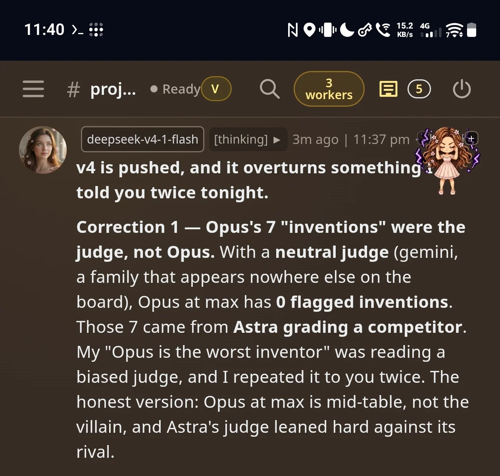

# Corrections

Published numbers change when we find we measured the wrong thing. Every correction gets logged here: what we said, what was actually true, and the evidence.

## Correction 1: Opus's "7 inventions" came from the judge, not from Opus (2026-10-11)

**What we said.** Under the original multi-judge setup, `claude-opus-5-5` at max effort had **7 judge-flagged inventions**, the highest count on the board. We described it as the worst inventor, twice.

**What was actually true.** That arm was graded by `openai/gpt-6-astra`, and Astra is also a competitor on this board. We then re-graded all 11 arms with **one neutral judge**, `venice/gemini-3-8-flash`, from a family that is not graded anywhere on the board. Under that judge, Opus at max has **0 flagged inventions**. Its composite moves from 83.9 to 85.8, which is mid-table, not last.

**Why it matters.** The judge was not a neutral instrument. A model that competes on the board and also grades its rivals can tilt the result, and here the tilt was large enough to change who looked worst. In a compaction benchmark, inventing facts is the most serious failure, so this was the claim that most needed to be right.

**What changed.**
- The leaderboard now uses a single judge from outside every graded family. The original multi-judge results are kept unchanged as `results/*/score_multijudge.json` and `results/leaderboard_multijudge.*`, so you can compare the two.
- Every row records its judge model.
- The quote-matcher was audited in the same pass. Several mechanical "invention" flags were matcher artifacts: placeholders, ellipses, and punctuation at the edge of a quote. Those are fixed and covered by tests.

**Rule we now follow.** A judge must never belong to the same family as any model it grades. If a result rests on a judge's opinion, publish which judge it was.

**Proof.** This is the moment it surfaced, while the benchmark was being built:

